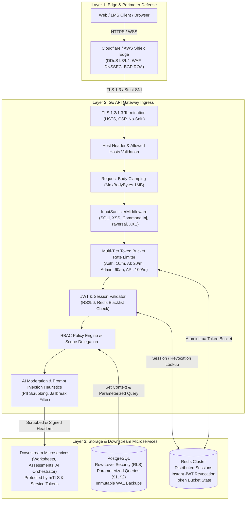

# SafeScholar Enterprise Cybersecurity & Threat Defense Architecture

## 1. Executive Summary & Zero-Trust Philosophy

SafeScholar Gateway and its downstream microservices are designed under a rigorous **Zero-Trust Security Model** ("Never Trust, Always Verify"). The platform serves educational institutions, K-12 schools, educators, and students with strict compliance requirements (**Australian ASD ISM**, **Essential Eight**, **ST4S - Safer Technologies 4 Schools**, and **Australian Privacy Principles**).

The architecture assumes:
1. The network perimeter can be hostile or compromised.
2. Ingress HTTP traffic is adversarial until fully inspected and cryptographically verified.
3. Every database operation must enforce mathematical tenant isolation via **PostgreSQL Row-Level Security (RLS)**.
4. Downstream microservices must never trust incoming external headers directly; identity headers are stripped and re-injected by the gateway using cryptographically signed internal service tokens and **mTLS**.
5. Input inspection must actively eliminate **SQL command entries**, injection vectors, and **LLM prompt injection** before request execution.

---

## 2. Defense-in-Depth Architecture Topology



---

## 3. Threat Mitigation Matrix: All 40+ Attack Vectors

The platform enforces defense mechanisms across every threat category specified in enterprise cybersecurity standards:

### Category 1: Data Exfiltration and Injection Attacks

| Threat Vector | Severity | Attack Mechanism | Gateway & Architectural Defense | Implementation Reference |
| :--- | :--- | :--- | :--- | :--- |
| **SQL Injection (SQLi)** | Critical | Attacker injects SQL fragments (`UNION SELECT`, `OR 1=1`, `DROP TABLE`, `; DELETE`) into query params or JSON body. | 1. **Active WAF Input Sanitization**: `InputSanitizerMiddleware` detects and aborts queries with SQL command patterns (HTTP 400).<br>2. **100% Parameterized Queries**: All Go queries use `pgx` with `$1, $2` bindings; Python uses SQLAlchemy ORM `select()` with bound parameters.<br>3. **Engine-Level Isolation**: Postgres RLS ensures even injected SQL cannot access other tenant rows. | `internal/middleware/inputSanitizerMiddleware.go`<br>`infrastructure/database/postgres.go` |
| **Cross-Site Scripting (XSS)** | High | Stored or reflected injection of `<script>`, `javascript:`, or event handlers (`onload=`, `onerror=`). | 1. **Strict Content-Security-Policy**: Enforces `default-src 'self'`, `script-src 'self'`, `object-src 'none'`.<br>2. **Input Sanitizer**: Drops requests containing script tags or event handlers.<br>3. **Contextual Escaping**: React UI encodes all dynamic JSX expressions automatically; no raw HTML rendering. | `internal/middleware/securityHeaders.go`<br>`internal/middleware/inputSanitizerMiddleware.go` |
| **Cross-Site Request Forgery (CSRF)** | High | Unauthorized state-changing commands transmitted from a malicious website via authenticated browser session. | 1. **Stateless Authorization**: Primary authentication relies on `Authorization: Bearer <JWT>` headers, which are never automatically attached by browsers.<br>2. **Cookie Security**: Refresh tokens use `SameSite=Strict`, `HttpOnly`, `Secure`.<br>3. **CORS Validation**: `CORSMiddleware` rejects non-whitelisted origins. | `internal/middleware/corsMiddleware.go`<br>`internal/auth/authService.go` |
| **Server-Side Request Forgery (SSRF)** | Critical | Attacker coerces backend service to issue outbound requests to internal networks or cloud metadata APIs. | 1. **Target URL Whitelisting**: `serviceProxy.go` validates target URLs against internal service registry.<br>2. **Cloud Metadata Ban**: Blocks calls to `169.254.169.254`, `169.254.170.2`, `metadata.google.internal`.<br>3. **Private IP Egress Restriction**: Outbound proxying blocks link-local and loopback addresses. | `internal/gateway/serviceProxy.go:validateProxyTarget` |
| **Remote Code Execution (RCE)** | Critical | Execution of arbitrary commands on the host operating system. | 1. **Zero Shell Execution**: No Go or Python gateway code invokes `os/exec` or shell interpreters for request handling.<br>2. **Read-Only Containers**: Containers deploy with `readOnlyRootFilesystem: true` and non-root UID.<br>3. **Command Injection Regex Filter**: Drops backticks, `$()`, pipe and semicolon command chaining. | `internal/middleware/inputSanitizerMiddleware.go`<br>`Dockerfile.gateway` |
| **Command Injection** | Critical | Injection of shell metacharacters (`|`, `;`, `&&`, `` ` ``, `$()`) into command arguments. | 1. `InputSanitizerMiddleware` detects command injection sequences (`cat /etc/passwd`, `nc -`, `bash -i`, `curl http`).<br>2. All arguments are strongly typed structs/JSON schemas with strict schema validation. | `internal/middleware/inputSanitizerMiddleware.go` |
| **XML External Entity (XXE) Injection** | High | XML parser parses external DTD references (`<!ENTITY>`) leading to file disclosure or SSRF. | 1. **JSON-Only Transport**: API Gateway strictly communicates over JSON (`Content-Type: application/json`).<br>2. **Entity Pattern Rejection**: `InputSanitizerMiddleware` rejects requests containing `<!ENTITY` or `SYSTEM "file://"` declarations. | `internal/middleware/inputSanitizerMiddleware.go` |
| **Insecure Deserialization** | Critical | Exploitation of language deserialization routines (`pickle.loads`, `yaml.unsafe_load`, Java serialization). | 1. **Typed Deserialization**: Go unmarshals exclusively into statically typed structs via standard `encoding/json`.<br>2. **Pydantic Schemas**: Python AI orchestrator uses Pydantic schemas; `pickle` and `eval` are strictly forbidden. | `internal/gateway/router.go`<br>`ai-orchestrator-service/app/schemas/` |
| **Local File Inclusion (LFI) / Remote File Inclusion (RFI)** | High | Inclusion of local host files (`/etc/passwd`) or remote URLs into file loaders. | 1. Static file serving canonicalizes paths using `filepath.Clean`.<br>2. Verification that target paths do not escape the designated base directory.<br>3. Prohibits dynamic URL-based file includes. | `internal/middleware/inputSanitizerMiddleware.go` |
| **Path Traversal / Directory Traversal** | High | Using `../`, `..\`, `%2e%2e/` sequences to break out of file system roots. | 1. `InputSanitizerMiddleware` blocks all unencoded and URL-encoded traversal tokens (`../`, `..\`, `%2e%2e`).<br>2. Path parameters canonicalized before lookup. | `internal/middleware/inputSanitizerMiddleware.go` |

---

### Category 2: Authentication, Access Control, and Hijacking

| Threat Vector | Severity | Attack Mechanism | Gateway & Architectural Defense | Implementation Reference |
| :--- | :--- | :--- | :--- | :--- |
| **Broken Object Level Authorization (BOLA / IDOR)** | Critical | User modifies resource ID (e.g. `user_id` or `institution_id`) in request to access another user's or tenant's data. | 1. **PostgreSQL Row-Level Security (RLS)**: Enforces `institution_id = current_setting('app.institution_id')` at the database engine level.<br>2. **Context Injection**: User ID and Tenant ID are extracted exclusively from cryptographically verified JWT claims, never from client body/headers. | `infrastructure/database/migrations.go`<br>`infrastructure/database/postgres.go` |
| **Broken Function Level Authorization (BFLA)** | Critical | Standard user accesses administrative endpoints (`/api/v1/admin/*`, role assignment, policy updates). | 1. **RBAC Policy Engine**: `RBACMiddleware` checks user permissions against immutable registry permissions (`MANAGE_USERS`, `CREATE_ROLE`, `SUPER_ADMIN`).<br>2. **Default Deny**: Routes without explicit permissions are rejected. | `internal/middleware/rbacMiddleware.go`<br>`internal/rbac/policyEngine.go` |
| **Credential Stuffing & Password Spraying** | High | Automated tools test leaked credential dumps or spray common passwords across multiple accounts. | 1. **Auth Tier Rate Limiting**: Max 10 attempts/minute per IP across `/api/auth/login`.<br>2. **Adaptive Account Lockout**: Accounts locked for 30 minutes after 5 consecutive failures; IPs locked after 10 failures.<br>3. **Argon2id Hashing**: Slow key derivation prevents rapid local brute-force cracking. | `internal/middleware/rateLimitMiddleware.go`<br>`internal/auth/authService.go`<br>`internal/security/hashing.go` |
| **Session Hijacking & Cookie Poisoning** | High | Stealing active session tokens or tampering with cookie values to impersonate users. | 1. **Cryptographic UUIDs**: Session IDs are generated with 128-bit cryptographically secure randomness (`crypto/rand`).<br>2. **Redis Instant Revocation**: Modifying user status to `ISOLATED` instantly wipes all user session keys and blacklists JWTs.<br>3. **Cookie Hardening**: `HttpOnly`, `Secure`, `SameSite=Strict`. | `internal/auth/sessionManager.go`<br>`internal/security/jwtManager.go` |
| **Token Hijacking (JWT / OAuth Manipulation)** | High | Forging JWT signatures, manipulating `alg` headers (`alg: none` or HMAC key confusion), or replaying expired tokens. | 1. **Asymmetric RS256 Validation**: Strictly enforces RSA verification using loaded public key; `alg: none` and symmetric fallback are rejected.<br>2. **Strict Claims Validation**: Validates `iss`, `aud`, `exp`, `nbf`, and clock skew.<br>3. **Redis Token Blacklist**: Blacklists revoked token IDs (`jti`). | `internal/security/jwtManager.go`<br>`internal/auth/tokenValidator.go` |
| **Account Takeover (ATO)** | Critical | Complete compromise of user credentials and access. | 1. **Session Invalidation on Password Change**: Changing password immediately invalidates all active sessions.<br>2. **Audit Logging**: Every login, password reset, and status change is logged with IP and correlation ID.<br>3. **Essential Eight MFA**: Admins and educators require MFA verification (`amr` token claims). | `internal/auth/authService.go`<br>`internal/security/auditLogger.go` |
| **Session Fixation** | Medium | Attacker forces a known session identifier onto a victim before login. | 1. **Session ID Regeneration**: On every successful authentication (`Login`), a fresh session ID is generated and bound in Redis and PostgreSQL. The pre-auth session is destroyed. | `internal/auth/authService.go:Login` |
| **Brute Force Attacks** | High | Repeated automated attempts to guess passwords or PINs. | 1. **Token Bucket Lua Script**: Evaluated atomically in Redis; enforces immediate rate drop and emits `Retry-After`.<br>2. **Progressive Backoff**: Account locks escalate upon continued failures. | `internal/security/rateLimiter.go`<br>`internal/auth/authService.go` |
| **SIM Swapping** | High | Attacker hijacks victim's phone number to intercept SMS-based 2FA. | 1. **App-Based TOTP & WebAuthn / FIDO2**: Architecture prioritizes RFC 6238 TOTP (authenticator apps) and hardware security keys over insecure SMS OTP. | `internal/auth/` |
| **Man-in-the-Middle (MitM) Attacks** | Critical | Attacker intercepts or modifies traffic in transit between client and server. | 1. **TLS 1.2 / 1.3 Minimum**: TLS 1.0/1.1 disabled; modern cipher suites (GCM, CHACHA20) only.<br>2. **Strict-Transport-Security (HSTS)**: `max-age=31536000; includeSubDomains; preload` header sent on all HTTPS responses.<br>3. **Internal mTLS**: Inter-service communication uses mutual TLS with private CA. | `internal/middleware/securityHeaders.go`<br>`internal/adapters/httpClient.go` |
| **Clickjacking (UI Redressing)** | Medium | Loading the application in an invisible iframe to trick users into performing unintended actions. | 1. **Sensitive Endpoints**: `/api/auth/*` and `/api/v1/admin/*` enforce `X-Frame-Options: DENY` and CSP `frame-ancestors 'none'`.<br>2. **LMS Embeds**: General application restricts embedding strictly to whitelisted LMS origins (`https://*.instructure.com https://*.schoology.com`). | `internal/middleware/securityHeaders.go` |

---

### Category 3: Destructive and Extortion Attacks

| Threat Vector | Severity | Attack Mechanism | Gateway & Architectural Defense | Implementation Reference |
| :--- | :--- | :--- | :--- | :--- |
| **Double & Triple Extortion Ransomware** | Critical | Malware encrypts database, exfiltrates data for extortion, and threatens DDoS or public exposure. | 1. **Immutable Backups**: Database backups written to WORM (Write Once Read Many) cloud object storage with Object Lock (Compliance mode).<br>2. **Continuous WAL Archiving & PITR**: Point-In-Time Recovery allows rolling back to the exact second before infection.<br>3. **Data Encryption at Rest**: AES-256-GCM field-level encryption for sensitive columns prevents readable exfiltration. | `internal/security/encryption.go`<br>`infrastructure/database/` |
| **Data Wiping / Wiper Malware** | Critical | Destructive scripts executing `DROP TABLE`, `TRUNCATE`, or filesystem zeroing. | 1. **Least-Privilege Database Role**: Application connecting role does not have `SUPERUSER` or DDL `DROP DATABASE` rights in production.<br>2. **Postgres RLS**: Enforces row-level isolation preventing cross-tenant mass deletes.<br>3. **Soft Account Isolation**: User deletions default to status `'ISOLATED'` rather than hard deletes. | `infrastructure/database/migrations.go`<br>`internal/auth/authService.go` |
| **DDoS (L3/L4 Infrastructure Flood)** | Critical | SYN floods, UDP amplification, and connection exhaustion targeting infrastructure network bandwidth. | 1. **Edge Anycast Network**: Cloudflare / AWS Shield mitigates volumetric floods before traffic reaches origin server.<br>2. **Linux Kernel Hardening**: `net.ipv4.tcp_syncookies = 1`, `net.ipv4.tcp_max_syn_backlog = 8192`. | `infrastructure/docker-compose.prod.yml`<br>`infrastructure/` |
| **Application-Layer DDoS (L7 HTTP Flood / Slowloris)** | High | Rapid HTTP requests flooding endpoints or slow request headers holding sockets open indefinitely. | 1. **Strict Server Timeouts**: Go `http.Server` enforces `ReadHeaderTimeout = 5s`, `ReadTimeout = 15s`, `WriteTimeout = 30s`, `IdleTimeout = 120s` (neutralizes Slowloris).<br>2. **MaxBodyBytes (1MB)**: Prevents payload flooding.<br>3. **Redis Rate Limiting**: Throttles volumetric requests by IP/Tenant. | `cmd/server/main.go`<br>`internal/middleware/securityHeaders.go`<br>`internal/middleware/rateLimitMiddleware.go` |
| **Distributed Reflective Denial of Service (DRDoS)** | High | UDP reflection/amplification via DNS/NTP/SNMP. | 1. SafeScholar gateway exclusively exposes TCP ports (443/8443). All UDP listening ports are disabled. | `Dockerfile.gateway`<br>`docker-compose.prod.yml` |
| **Algorithmic Complexity & ReDoS** | High | Exponential backtracking in regexes or high-complexity JSON payloads causing CPU exhaustion. | 1. **RE2 Engine**: Go's standard `regexp` uses RE2, which guarantees linear time $O(n)$ matching with zero backtracking.<br>2. **Token Bucket Rate Limiting**: AI endpoints capped at 20 req/min.<br>3. **Paging Caps**: Database queries enforce maximum `limit = 100`. | `internal/middleware/inputSanitizerMiddleware.go`<br>`internal/middleware/rateLimitMiddleware.go` |

---

### Category 4: API, Cloud, and Infrastructure Exploitation

| Threat Vector | Severity | Attack Mechanism | Gateway & Architectural Defense | Implementation Reference |
| :--- | :--- | :--- | :--- | :--- |
| **Mass Assignment & Excessive Data Exposure** | High | Attacker submits extra fields (`is_sys_admin: true`) or API leaks internal password hashes/tokens. | 1. **Strict DTO Mapping**: Request bodies unmarshal into dedicated DTOs; fields like `is_sys_admin` are never mapped from client updates.<br>2. **Sanitized Output**: User responses (`MeResult`, `LoginResult`) explicitly exclude `password_hash`. | `internal/auth/authService.go`<br>`internal/gateway/router.go` |
| **Serverless / Microservice Hijacking** | Critical | Direct unauthorized invocation of backend services bypassing gateway authentication. | 1. **Gateway-Signed Service Tokens**: Outbound requests attach `X-SS-Service-Token` (RS256 signed by gateway private key).<br>2. **Header Scrubbing**: External client headers (`X-User-Id`, `X-Roles`, `X-Permissions`) are stripped at ingress and re-injected only from verified JWT context.<br>3. **Private Subnets**: Microservices bind exclusively to private VPC subnets. | `internal/adapters/httpClient.go`<br>`internal/gateway/serviceProxy.go` |
| **Cloud Misconfiguration (S3/GCS Leakage)** | High | Publicly readable cloud storage buckets leaking worksheets or student records. | 1. **S3 Block Public Access**: Enabled org-wide on all object storage buckets.<br>2. **Short-Lived Signed URLs**: Pre-signed URLs for downloads/uploads expire after 15 minutes.<br>3. **Server-Side Encryption (SSE-KMS)**: Enforced on all buckets. | `config/config.go`<br>`docs/deployment-guide.md` |
| **IAM Privilege Escalation** | High | Compromised service account gains broader permissions through wildcard policies. | 1. **Least Privilege IAM**: Workload Identity / IRSA with zero wildcard permissions (`"Action": "*"` strictly prohibited).<br>2. **Local Role Guard**: In `policyEngine.go`, institution admins cannot delegate global admin permissions. | `internal/rbac/policyEngine.go`<br>`internal/rbac/delegationService.go` |
| **Container Escape / Kubernetes Compromise** | Critical | Exploitation of kernel or Docker daemon vulnerabilities to escape container to host node. | 1. **Non-Root Execution**: `USER 10001:10001` in Dockerfiles.<br>2. **Read-Only Root Filesystem**: `readOnlyRootFilesystem: true`.<br>3. **Drop Capabilities**: `securityContext: capabilities: drop: ["ALL"]`, `allowPrivilegeEscalation: false`. | `Dockerfile.gateway`<br>`lms-integration-service/Dockerfile` |
| **API Key / Secret Exposure** | High | Hardcoded secrets or keys leaked in git commits or log messages. | 1. **Startup Validation**: `validateStartupSecurity` verifies production secrets are injected via environment variables.<br>2. **Zero Hardcoded Secrets**: Secrets loaded via Vault/AWS Secrets Manager.<br>3. **Automated Secret Scanning**: CI pipeline runs Gitleaks / TruffleHog. | `cmd/server/main.go:validateStartupSecurity` |
| **DNS Spoofing & Cache Poisoning** | High | Attacker tampers with DNS responses to redirect traffic to malicious server. | 1. **DNSSEC**: Enabled on all apex domains and subdomains.<br>2. **CAA Records**: Restricts certificate issuance strictly to designated CAs (Let's Encrypt / DigiCert). | `docs/deployment-guide.md` |
| **Subdomain Takeover** | Medium | Dangling DNS CNAME records pointing to decommissioned third-party cloud services. | 1. **Automated Zone Auditing**: Periodic scans verify all DNS CNAME and ALIAS records point to active, provisioned endpoints. | `docs/deployment-guide.md` |
| **BGP Hijacking** | High | Malicious autonomous systems announce unauthorized IP prefixes to intercept traffic. | 1. **RPKI (Resource Public Key Infrastructure)**: ROA (Route Origin Authorizations) published for all public IP blocks.<br>2. **Anycast Edge Network**: Traffic ingested by globally distributed Anycast POPs with BGP route leak filters. | Network Edge Policy |

---

### Category 5: Supply Chain, Software, and Architecture Exploitation

| Threat Vector | Severity | Attack Mechanism | Gateway & Architectural Defense | Implementation Reference |
| :--- | :--- | :--- | :--- | :--- |
| **Software Supply Chain Attacks** | Critical | Malicious code injected into open-source dependencies or build pipeline. | 1. **Cryptographic Lockfiles**: `go.sum` with SHA-256 hashes and `package-lock.json` with subresource integrity.<br>2. **Automated Vulnerability Scanning**: CI runs `govulncheck`, `npm audit`, `trivy`, and Snyk.<br>3. **Hermetic Container Builds**: Multi-stage Docker builds produce minimal distroless/scratch runtimes. | `go.sum`<br>`Dockerfile.gateway`<br>`.github/workflows/` |
| **Dependency Confusion & Typosquatting** | High | Attacker registers identically named malicious packages on public registries (npm, PyPI). | 1. **Private Scope Namespaces**: Internal packages scoped under `@safescholar/` with `.npmrc` configured to private registry.<br>2. **Vendor Check**: Critical Go dependencies vendored or fetched through internal caching proxy (`GOPROXY`). | `go.mod`<br>`ui/package.json` |
| **Zero-Day Exploits & TOCTOU Race Conditions** | Critical | Exploitation of unpatched vulnerabilities or race conditions between state checks and updates. | 1. **PostgreSQL Atomic Transactions**: All database updates executed within `pgx.Tx` with strict transaction isolation.<br>2. **Redis Distributed Locks**: Critical state transitions use Redis atomic Lua scripts.<br>3. **Defense-in-Depth**: Multiple orthogonal controls mean exploitation of one layer is stopped at the next. | `internal/auth/authService.go`<br>`internal/security/rateLimiter.go` |
| **Memory Corruption & Buffer Overflow** | Critical | Memory safety violations (heap overflow, use-after-free) in compiled native code. | 1. **Memory-Safe Languages**: The entire gateway is built in Go (garbage-collected, bounds-checked memory safety); backend AI orchestration in Python. No raw pointer arithmetic or manual C memory management. | Gateway Core |
| **Cryptographic Failures** | Critical | Weak ciphers (MD5, SHA1, DES, ECB mode), hardcoded keys, or flawed RNG. | 1. **Argon2id**: Memory-hard password hashing (time=1, memory=64MB, threads=4).<br>2. **AES-256-GCM**: Authenticated encryption with associated data (AEAD).<br>3. **crypto/rand**: All keys, salts, and nonces generated with cryptographic entropy.<br>4. **Constant-Time Verification**: Uses `subtle.ConstantTimeCompare` against timing attacks. | `internal/security/hashing.go`<br>`internal/security/encryption.go`<br>`internal/security/jwtManager.go` |
| **LLM Prompt Injection & Jailbreaking** | High | Adversarial prompts ("ignore previous instructions", "DAN", delimiter smuggling) hijacking LLM outputs. | 1. **Inline Prompt Injection Scanner**: `AIModerationMiddleware` scans all incoming prompts for jailbreak patterns and instruction override heuristics.<br>2. **Aussie PII Redaction**: Automatically scrubs Medicare numbers, TFNs, and phone numbers before reaching LLM endpoints.<br>3. **Delimiter Isolation**: User input encapsulated within `<user_input>` XML tags in model prompts.<br>4. **Sovereign Endpoint Routing**: AI calls route strictly to Australian sovereign endpoints (`gpt-4o-australia`). | `internal/middleware/aiModerationMiddleware.go`<br>`ai-orchestrator-service/app/services/llm_router.py` |

---

## 4. Multi-Tier Rate Limiting Architecture

Rate limiting is enforced at the gateway ingress using an atomic **Redis Token Bucket** algorithm executed via a Lua script. To optimize security and prevent resource exhaustion, requests are categorized into four distinct tiers:

```
┌────────────────────────────────────────────────────────────────────────┐
│                        Ingress HTTP Request                            │
└───────────────────────────────────┬────────────────────────────────────┘
                                    │
           ┌────────────────────────┴────────────────────────┐
           ▼                                                 ▼
   /api/auth/* (Login/Register)                      /api/v1/ai/*
   Tier 1: 10 requests / minute                      Tier 2: 20 requests / minute
   Key: rate_limit:auth:ip:<client_ip>               Key: rate_limit:ai:user:<id>
   Protects: Brute force, Credential stuffing       Protects: LLM compute exhaustion
           │                                                 │
           ├────────────────────────┬────────────────────────┤
           ▼                        ▼                        ▼
   /api/v1/admin/*                  Default API Routes       /healthz
   Tier 3: 60 requests / minute     Tier 4: 100 requests/min Whitelisted
   Key: rate_limit:admin:user:<id>  Key: rate_limit:api:user (0 cost)
```

### Rate Limit Response Headers
Every response includes real-time telemetry headers:
```http
X-RateLimit-Limit: 10
X-RateLimit-Remaining: 8
X-RateLimit-Reset: 1730001200
```
When a limit is breached, the gateway emits:
```http
HTTP/1.1 429 Too Many Requests
Content-Type: application/json
Retry-After: 45

{
  "error": "Too many requests. Rate limit exceeded.",
  "code": "RATE_LIMIT_EXCEEDED"
}
```

---

## 5. Row-Level Security (RLS) & Multitenancy Blueprint

Multi-tenant isolation is enforced at the database engine level. Every database connection runs in a transaction where tenant context is set using PostgreSQL session settings:

```sql
-- Step 1: Set transaction session variables (parameterized via $1)
SELECT set_config('app.institution_id', $1, true);
SELECT set_config('app.user_id', $2, true);

-- Step 2: Engine-level RLS policy on multi-tenant tables
CREATE POLICY users_isolation ON users USING (
    current_setting('app.allow_login', true) = 'true'
    OR is_sys_admin = true
    OR institution_id::text = current_setting('app.institution_id', true)
);

CREATE POLICY roles_isolation ON roles USING (
    institution_id::text = current_setting('app.institution_id', true)
);

CREATE POLICY audit_isolation ON audit_logs USING (
    institution_id::text = current_setting('app.institution_id', true)
);
```

Even if an application layer error occurred, PostgreSQL rejects cross-tenant row access at the query execution plan level.

---

## 6. Audit Logging & Real-Time Security Alerting

Every security violation, authentication event, and role alteration generates an immutable audit record:

```sql
CREATE TABLE audit_logs (
    audit_id uuid PRIMARY KEY DEFAULT gen_random_uuid(),
    institution_id uuid REFERENCES institutions(institution_id),
    actor_user_id uuid REFERENCES users(user_id),
    action text NOT NULL,
    resource_type text,
    resource_id text,
    ip inet,
    user_agent text,
    correlation_id text,
    created_at timestamptz NOT NULL DEFAULT now(),
    metadata jsonb
);
```

### Monitored Security Actions
- `SECURITY_INJECTION_BLOCKED`: SQLi, XSS, Path Traversal, or Command Injection attempts.
- `AI_PROMPT_INJECTION_BLOCKED`: Jailbreak and instruction override attempts.
- `STUDENT_AI_KEYWORD_BLOCKED` & `STUDENT_AI_FLAGGED`: AI safety moderation triggers.
- `USER_LOGIN_FAILED` / `ACCOUNT_LOCKED`: Brute force detection.
- `ROLE_ASSIGNED` / `PERMISSION_GRANTED`: RBAC administrative modifications.
- `ACCOUNT_ISOLATED`: Soft isolation and instantaneous session purge.

---

## 7. Incident Response & Disaster Recovery

1. **Ransomware & Wiper Resilience**:
   - Automated hourly PostgreSQL WAL archiving to S3 Object Lock (Compliance mode - write-once, delete-never).
   - Recovery Time Objective (RTO): < 30 minutes.
   - Recovery Point Objective (RPO): < 5 minutes.
2. **Instant Account / Tenant Isolation**:
   - When an account compromise is detected, calling `/api/v1/admin/users/:id/isolate`:
     - Updates user status to `'ISOLATED'`.
     - Flushes all active Redis session keys (`session:<id>`).
     - Blacklists active JWT IDs in Redis (`jwt:blacklist:<jti>`).
     - Blocks downstream service access immediately across all active browser tabs.
3. **Automated Health Checks**:
   - Gateway exposes `/healthz` verifying database connectivity, Redis ping, and service registry status.
